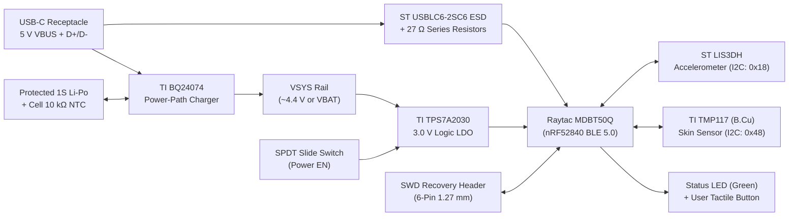

A compact **40 mm near-circular, 4-layer wrist-worn Bluetooth Low Energy (BLE) sensor prototype** developed from an open-ended engineering design brief. Built around the **Raytac MDBT50Q-1MV2 module** (Nordic Semiconductor nRF52840 SoC), the device integrates continuous three-axis motion tracking, high-precision underside skin-temperature sensing, standalone linear Li-Po battery charging with autonomous power-path management, and a native USB-C interface for data logging and DFU firmware updates.

**Status: Reviewable routed KiCad 10 engineering prototype.** The electrical schematic and 4-layer layout are fully routed and digitally verified in KiCad 10.0.7 with **zero ERC violations, zero DRC errors, and zero open/unconnected nets** (17 cleanup warnings). Raw XML netlist cross-checking passed all 222 physical footprint pins. Physical board fabrication, battery pack qualification, firmware bring-up, and mechanical enclosure characterization remain planned milestones.

[View Project Repository](https://github.com/xmyoot/compact-bluetooth-wearable) · [Schematic PDF](https://github.com/xmyoot/compact-bluetooth-wearable/blob/main/analysis/schematic.pdf) · [Architecture Specification](https://github.com/xmyoot/compact-bluetooth-wearable/blob/main/docs/architecture.md) · [Design Review Report](https://github.com/xmyoot/compact-bluetooth-wearable/blob/main/docs/design-review.md) · [Bring-Up Plan](https://github.com/xmyoot/compact-bluetooth-wearable/blob/main/docs/bring-up.md) · [Manufacturing Preview](https://github.com/xmyoot/compact-bluetooth-wearable/tree/main/manufacturing/engineering-preview-NOT-FOR-FAB)

---

## 3D Hardware Overview

<p align="center">
  
  
</p>

*Figure 1: Native 3D CAD rendering of the Compact Bluetooth Wearable prototype (Rev A). Left: Top assembly with Raytac nRF52840 module, USB-C receptacle, BQ24074 charger, slide power switch, user/reset tactile switches, and LIS3DH accelerometer. Right: Underside layout highlighting the skin-facing TMP117 temperature sensor with local plane thermal exclusion, JST battery connector footprint, and 6-pin SWD recovery interface.*

---

## Technical Specifications & Architecture

| Subsystem | Component / Implementation | Key Specifications & Engineering Details |
| :--- | :--- | :--- |
| **PCB Form Factor** | 40 mm diameter near-circular outline | Truncated flat USB edge (~40.0 × 38.0 mm), 4 layers, 1.0 mm nominal FR-4 |
| **Layer Stackup** | F.Cu / In1.Cu / In2.Cu / B.Cu | Top signals/components, In1 solid GND reference, In2 signal escapes + GND fill, B.Cu underside sensors/test pads |
| **Design Rules** | Enforced 0.15 / 0.60 / 0.30 mm limits | 0.15 mm track/clearance, 0.60 mm via diameter with 0.30 mm drill, 0.25 mm copper-to-edge; no microvias |
| **Compute Core & Radio** | Raytac MDBT50Q-1MV2 (nRF52840) | 64 MHz 32-bit ARM Cortex-M4F, 1 MB Flash, 256 KB RAM, 2.4 GHz transceiver (BLE 5.0, mesh, Thread), integrated chip antenna |
| **Antenna Keepout** | 4-layer copper void at north edge | Complete 4-layer no-track, no-via, no-pour keepout extending through $y = 85.05\,\text{mm}$ (3.8 mm inward from module body) |
| **Motion Sensing** | STMicroelectronics LIS3DHTR | 3-axis ultra-low-power accelerometer ($\pm 2g / \pm 4g / \pm 8g / \pm 16g$), I2C interface (`0x18`, SA0 strapped low via $0\,\Omega$ R19), motion interrupt to MCU P0.27 |
| **Skin Temperature** | Texas Instruments TMP117AIDRVR | Clinical-grade digital temperature sensor ($\pm 0.1\,^\circ\text{C}$ over $-20\,^\circ\text{C}$ to $+50\,^\circ\text{C}$), I2C (`0x48`), alert to MCU P0.29; unpasted floating EP on B.Cu |
| **Battery Charger** | Texas Instruments BQ24074RGTR | Linear single-cell Li-ion/Li-Po charger with dynamic power-path management; 100 mA charge current ($8.87\,\text{k}\Omega$ ISET), 10% termination, 10 kΩ NTC thermistor input |
| **System LDO** | Texas Instruments TPS7A2030PDBVR | 3.0 V logic rail, 300 mA capability, ultra-low noise ($9.5\,\mu\text{V}_{\text{RMS}}$), 135 mV dropout @ 300 mA; enable controlled by mechanical slide switch |
| **Battery Monitoring** | High-impedance resistor divider | $1\,\text{M}\Omega / 1\,\text{M}\Omega$ scaling ($0.5\times$ ratio) with 100 nF capacitor ($\tau \approx 50\,\text{ms}$) into nRF52840 SAADC input (`AIN7` / P0.31); $2.1\,\mu\text{A}$ draw @ 4.2 V |
| **USB Interface** | 16-Pin USB Type-C (GCT USB4105) | USB 2.0 Full-Speed (12 Mbps) data for DFU bootloader/CDC; ST USBLC6-2SC6 ESD clamp, $27\,\Omega$ series resistors, $5.1\,\text{k}\Omega$ CC pulldowns |
| **Debug & Recovery** | 6-pin 1.27 mm pitch SWD header | Target voltage sensing, SWDIO, SWCLK, GND, and RESET_N; ensures recovery before USB bootloader is flashed |

---

## System Block Diagram



---

## Deep Dive: Engineering Design Decisions

### 1. Dynamic Power-Path Architecture & Autonomous Charging

In wearable devices, users frequently expect the device to charge reliably from standard USB ports while allowing the logic system to be completely powered down. Direct battery-connected architectures suffer from charge termination confusion when system loads draw current during battery taper:

<p align="center">
  
</p>

*Figure 2: Top-side power management island featuring the BQ24074 VQFN charger (center), TPS7A2030 SOT-23-5 regulator, and ceramic decoupling arrays.*

- **Dynamic Power-Path Separation (NVDC):** The BQ24074 separates the incoming USB power (`VBUS`), the battery terminal (`VBAT`), and the internal system rail (`VSYS`). When USB power is connected, `VSYS` is regulated to approximately 4.4 V, directly powering the downstream 3.0 V LDO regardless of battery state of charge. This guarantees that a dead or fully depleted battery does not prevent immediate startup when plugged into USB.
- **Independent Battery Charging & Logic Shutdown:** The SPDT slide switch (`SW1`) controls the enable pin (`EN`) of the TPS7A2030 LDO rather than physically breaking high-current battery leads. When switched off, the logic processor and sensors enter true zero-power shutdown, yet the BQ24074 continues autonomously monitoring battery state, evaluating the cell-mounted NTC thermistor, and managing CC/CV charge termination at 100 mA.
- **USB Input Current Compliance:** The BQ24074's `EN1` and `EN2` pins are routed to nRF52840 GPIOs (`P0.38` and `P0.39`) with external $100\,\text{k}\Omega$ pull-down resistors defaulting to `EN1=0, EN2=0` (USB100 mode, $\le 100\,\text{mA}$). The system adheres strictly to USB specifications by drawing no more than 100 mA from an un-enumerated host. Once the nRF52840 completes USB enumeration and receives host permission, firmware can toggle to USB500 mode ($500\,\text{mA}$ limit) or suspend input power entirely.
- **Cell Protection & NTC Safety:** To preserve precious PCB space on the 40 mm circular disc, primary battery safety (overvoltage, undervoltage cutoff, overcurrent) is allocated to a qualified protection circuit integrated directly inside the battery pack. The board provides a dedicated 3-pin JST PH harness connector routing `BAT+`, `BAT-`, and the cell-mounted $10\,\text{k}\Omega$ NTC thermistor into the BQ24074's `TS` pin to enforce JEITA thermal charging windows.

---

### 2. Skin Temperature Monitoring & Underside Thermal Isolation

Accurate skin-temperature sensing in a wearable device is notoriously difficult due to internal self-heating from the battery charger, voltage regulator, and RF power amplifier:

<p align="center">
  
</p>

*Figure 3: Underside layout highlighting the TMP117 skin-facing temperature sensor (U5) isolated from copper pours and located away from top-layer power dissipation.*

- **TI TMP117 High-Accuracy Sensor:** The TMP117AIDRVR provides clinical-grade $\pm 0.1\,^\circ\text{C}$ temperature resolution ($0.0078125\,^\circ\text{C}$ LSB) with zero calibration requirements over the human body temperature envelope ($30\,^\circ\text{C}$ to $45\,^\circ\text{C}$).
- **Opposite-Face Placement:** The sensor is placed exclusively on the bottom layer (`B.Cu`), making direct physical contact with the skin (or through a thermally conductive, electrically insulating enclosure pad), while the power-path charger (`U2`) and LDO (`U3`) reside on the top layer (`F.Cu`).
- **Floating Exposed Pad & Copper Void:** Following TI's official application guidance for rigid boards, the TMP117's thermal die-attach pad (Pad 7) has **no solder paste aperture and is left electrically unconnected**. Furthermore, local ground and signal fills are kept back from the sensor package to reduce thermal mass, preventing the PCB from acting as a heat sink that couples internal electronics heating into the skin measurement.
- **Distinction Between Skin and Core Body Temperature:** The engineering architecture strictly documents that measured values represent local wrist surface skin temperature and trends. True core-body temperature estimation requires proprietary algorithmic offsets and mechanical contact validation on a characterized thermal mannequin fixture.

---

### 3. RF Layout & Multi-Layer Antenna Exclusion

The wearable utilizes a pre-certified module—the **Raytac MDBT50Q-1MV2**—which integrates the nRF52840 SoC along with a high-performance ceramic chip antenna, eliminating discrete RF matching tolerances:

<p align="center">
  
</p>

*Figure 4: North board edge showing the Raytac MDBT50Q module with its antenna overhang positioned above the strict 4-layer copper keepout.*

- **Strict 4-Layer Copper Keepout:** To achieve specified BLE radiation efficiency and omnidirectional range, the north edge of the board incorporates an explicit rule area covering **all four copper layers (F.Cu, In1.Cu, In2.Cu, B.Cu)** through $y = 85.05\,\text{mm}$. No traces, vias, or ground copper pours are permitted within 3.8 mm of the module's north body edge.
- **Decoupling Loop Priority:** High-frequency $100\,\text{nF}$ and bulk $10\,\mu\text{F}$ capacitors were manually placed and prioritized within 2.5 mm of module power pins (`VDD`, `VBUS`) and regulator outputs before any non-critical signal routing was executed.
- **Solid RF Return Planes:** The internal layer `In1.Cu` provides a continuous, unbroken ground plane directly beneath the high-frequency digital lines and module pads, minimizing ground bounce and return loop areas.

---

## System Schematic Overview

The complete design is captured in a comprehensive, single-sheet A2 schematic in KiCad 10:

<p align="center">
  
</p>

*Figure 5: Complete native KiCad 10.0.7 schematic diagram showing power-path battery management, nRF52840 compute core, I2C sensor bus, USB-C protection, and SWD debug interface.*

---

## Assembly Drawings

<p align="center">
  
  
</p>

*Figure 6: Fabrication assembly documentation. Left: Top assembly drawing showing reference designators for the 44 primary SMT components. Right: Bottom assembly drawing detailing test points, battery connection pads, and underside sensor placement.*

---

## Layout Implementation & Routing Discipline

Early in the layout phase, an automated routing experiment was evaluated and immediately rejected when it attempted to neck down critical fabrication clearances below standard board-house tolerances and introduced broken ground returns.

A disciplined, rules-driven layout process was subsequently executed:
- **Geometry & Design Rules:** The board strictly complies with standard 4-layer capabilities: **0.15 mm minimum trace width and clearance**, **0.60 mm via diameter with 0.30 mm drill**, and **0.25 mm minimum copper-to-edge spacing**. No expensive blind, buried, or microvias are utilized.
- **Manual Routing Escapes:** Fine-pitch components (the 0.5 mm pitch BQ24074 VQFN and LIS3DH LGA-16) received custom fan-outs and ground stitching vias before completing trunk interconnections.
- **Zone Management & Net Continuity:** Plane fills on `In1.Cu` and `In2.Cu` were refilled and unified with dedicated ground bridge segments, ensuring low-impedance return paths between digital logic and charging blocks.

```
Total Track Segments: 868
Total Vias: 140 (Through-hole 0.60 / 0.30 mm)
Minimum Track Width: 0.150 mm
Layer Count: 4 Copper Layers (1.0 mm FR-4)
SMT Placements: 44 parts + 6 test pads = 50 total footprints
```

---

## Power Budget & Operating Sensitivity

| Mode / Subsystem | Estimated Battery Draw | Architectural Basis |
| :--- | :--- | :--- |
| **System Off (Slide Switch Open)** | $\sim 4.2\,\mu\text{A}$ | BQ24074 BAT pin leakage ($\sim 2.1\,\mu\text{A}$) + $1\,\text{M}\Omega / 1\,\text{M}\Omega$ battery divider ($2.1\,\mu\text{A}$) |
| **BLE Advertising & Sensor Sampling**| $0.5 - 2.0\,\text{mA}$ avg | Depending on connection/advertising interval (e.g. 1 Hz accelerometer, 0.2 Hz temperature) |
| **Radio TX/RX Peak Burst** | $\sim 15 - 30\,\text{mA}$ peak | Short duration ($<2\,\text{ms}$) BLE packet bursts; decoupled by local bulk ceramic capacitors |
| **Status LED Active** | $\sim 1.0\,\text{mA}$ | High-efficiency green LED driven through $1\,\text{k}\Omega$ ballast resistor from 3.0 V rail |

For an illustrative $200\,\text{mAh}$ single-cell Li-Po battery operating at 80% usable capacity ($160\,\text{mAh}$), an average operating current of $0.5 - 1.5\,\text{mA}$ projects approximately **100 to 320 hours of continuous active logging**. Charging at 100 mA safely recharges a depleted cell in approximately 2.5 hours including CC/CV taper. *(Note: These numbers reflect arithmetic sensitivity analysis; empirical battery runtime will be measured during physical hardware bring-up).*

---

## Verification & Audit Results

The design underwent independent rule-based and cross-domain verification tools prior to repository sign-off:

| Audit Check | Authority | Status / Findings |
| :--- | :--- | :--- |
| **Schematic Electrical Rules (ERC)** | KiCad 10.0.7 native ERC | **0 Violations** (clean power domains and pin types) |
| **Design Rule Check (DRC)** | KiCad 10.0.7 native DRC + zone refill | **0 Errors, 0 Unconnected items**; 17 cleanup warnings (dangling escape stubs) |
| **Schematic / PCB Parity** | KiCad 10 netlist parity | **0 Discrepancies** |
| **Netlist-to-Pad Cross-Domain Audit** | Raw KiCad S-expression parser | **222 physical pins checked with 0 net mismatches** (including grounded USB shield) |
| **Bill of Materials Grouping** | KiCad BOM / Lifecycle parser | **26 unique manufacturer part number groups** across 50 footprints |
| **Preview Gerber Inspection** | `analyze_gerbers.py` | 0 fabrication errors; 3 heuristic layer extent warnings from copper keepout |

---

## Staged Prototype Bring-Up Plan

Before physical prototypes are worn or battery power applied, a strict 10-stage electrical verification plan is documented in `docs/bring-up.md`:

1. **Bench Inspection:** High-magnification optical inspection of soldering, solder bridge checks on QFN/LGA packages, and verification of antenna keepout clearance.
2. **Current-Limited Power Testing:** Applying 5.0 V from a bench power supply with a 50 mA current limit through USB-C while the logic slide switch is off. Measure `VBUS`, `VSYS`, and charge status pins; verify NTC resistor threshold shutdown.
3. **Regulator & Rail Validation:** Toggle the slide switch to enable the TPS7A2030; confirm stable 3.00 V logic rail with clean startup transient.
4. **Initial SWD Flashing:** Connect target debugger (Segger J-Link or CMSIS-DAP) using the 1.27 mm SWD header. Ensure debugger senses target voltage without back-powering the board. Flash diagnostic firmware image.
5. **Bus & Peripheral Enumeration:** Scan the I2C bus to verify communication at `0x18` (LIS3DH `WHO_AM_I` register) and `0x48` (TMP117 device ID). Verify user tactile switch, reset switch, and status LED.
6. **USB DFU Bootloader Installation:** Program a recoverable native USB bootloader over SWD. Verify USB enumeration and CDC virtual serial logging in both USB Type-C plug orientations.
7. **USB Input Current Verification:** Exercise the `CHG_EN1` and `CHG_EN2` control lines to confirm strict adherence to USB100 (100 mA limit), USB500, and suspend states.
8. **Battery Charge Profiling:** Connect a qualified protected single-cell Li-Po pack with its integrated NTC thermistor. Log charge current, thermal rise, CV taper, and automatic termination behavior.
9. **Thermal Mannequin Characterization:** Evaluate TMP117 skin temperature readings against a calibrated reference standard across varying ambient and charger operating states.
10. **RF & Range Testing:** Measure BLE packet reception, RSSI, and transmit range with representative hand/wrist tissue-simulating dielectric loading.

---

## Milestone Status & Claims Intentionally Pending

In accordance with rigorous engineering discipline, design prototyping is clearly separated from unverified physical claims:

- **Battery Pack Selection:** The PCB does not incorporate onboard cell-protection ICs; procurement of a commercial 1S Li-Po pack with certified integrated protection and matching 3-pin JST harness polarity is an open gating item.
- **USB Suspend & Inrush Compliance:** Input capacitance consists of two parallel $4.7\,\mu\text{F}$ capacitors ($9.4\,\mu\text{F}$ nominal). Tolerance stackup and host suspend policies require empirical oscilloscope measurement before declaring formal USB compliance.
- **Skin Temperature Validation:** Local surface temperature tracking is established in CAD; clinical accuracy and core temperature correlation require physical enclosure thermal modeling.
- **Firmware Development:** Embedded firmware architecture and pin definitions are mapped; full application code (BLE GATT services, sensor drivers, low-power state machine) will be developed on the assembled Rev A prototype.
