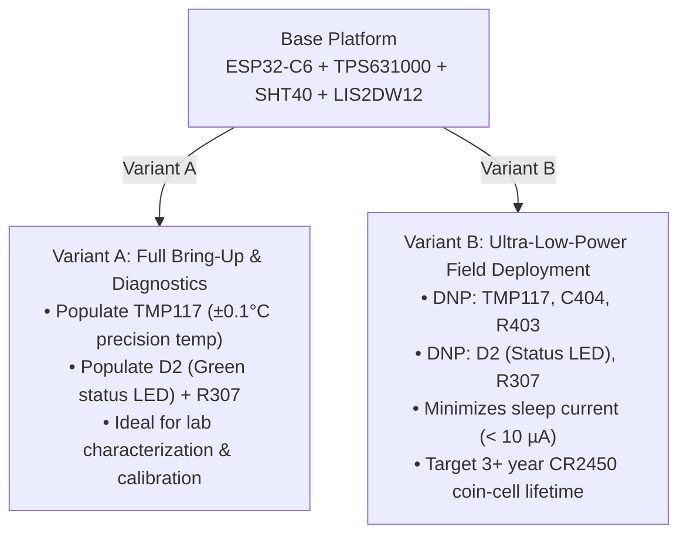
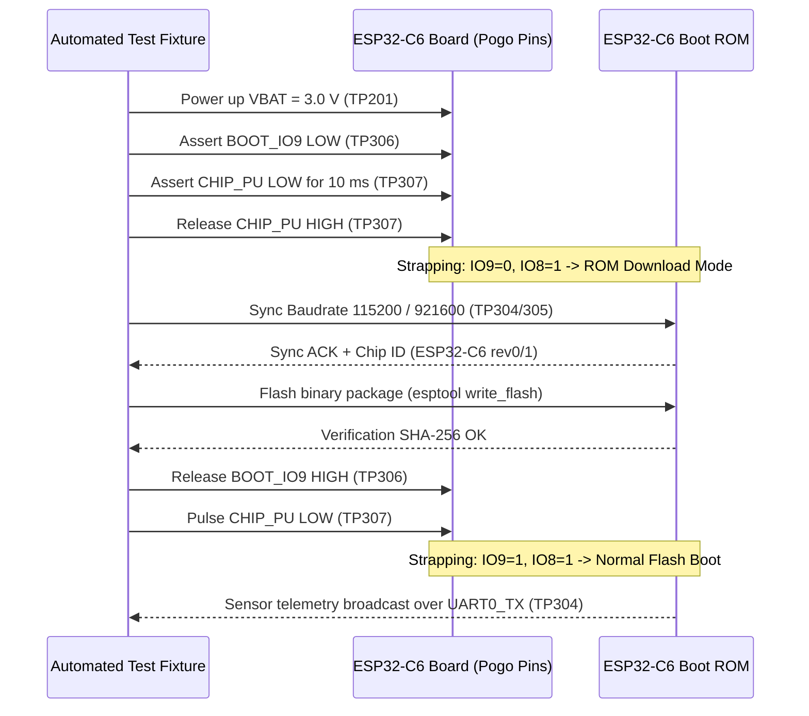

A commercial-grade, ultra-compact **31.5 mm circular, 4-layer IoT wireless sensor node** engineered from the ground up for harsh industrial environments, hermetic potting compound injection, and ultra-low-power coin-cell operation (**CR2450**, ~620 mAh). Powered by Espressif's **ESP32-C6-MINI-1-N4** (32-bit RISC-V @ 160 MHz, BLE 5.3, 802.15.4 / Zigbee / Thread, 4 MB Flash), the device integrates continuous environmental monitoring, motion sensing, robust reverse-polarity protection, high-efficiency synchronous buck-boost regulation, and native USB-C/UART diagnostic interfaces.

**Status: Approved for manufacturing (Fabrication-Ready).** The electrical schematic and 4-layer controlled-impedance layout are fully routed and digitally verified in KiCad 10 with **zero ERC violations, zero DRC errors, zero unconnected nets, and 100% height compliance ($\le 2.40\text{ mm}$)**. Full manufacturing deliverables—including RS-274X Gerbers, NC drill files, JLCPCB Component Placement List (CPL), dual BOM variants, and a unified 3D STEP mechanical model—are validated and staged for production.

[View Project Repository](https://github.com/xmyoot/esp32c6-ble-sensor-coin-cell) · [Design Specification & Review Gates](https://github.com/xmyoot/esp32c6-ble-sensor-coin-cell/blob/main/docs/DESIGN_SPEC_AND_GATES.md) · [Fabrication Deliverables](https://github.com/xmyoot/esp32c6-ble-sensor-coin-cell/tree/main/fab) · [Dual BOM Variants](https://github.com/xmyoot/esp32c6-ble-sensor-coin-cell/tree/main/bom) · [Schematic Architecture](https://github.com/xmyoot/esp32c6-ble-sensor-coin-cell/blob/main/esp32c6_ble_sensor.kicad_sch)

---

## 3D Hardware Overview

<p align="center">
  
</p>

<p align="center">
  
  
</p>

*Figure 1: Native raytraced 3D CAD visualization of the ESP32-C6 BLE Sensor Node (Rev A). Top: Primary component assembly featuring the ESP32-C6-MINI-1 module, northern RF antenna keepout, TPS631000 buck-boost stage with 100 µF MLCC decoupling reserve, sensor suite (SHT40, LIS2DW12, TMP117), Omron tactile switches, and dual pogo-pin test clusters. Bottom: Underside layout highlighting the through-hole CR2450 coin-cell holder retention pads and solid continuous ground plane.*

---

## Technical Specifications & Architecture

| Subsystem | Component / Implementation | Key Specifications & Engineering Details |
| :--- | :--- | :--- |
| **PCB Form Factor** | $\varnothing 31.50\text{ mm}$ circular outline | Dual alignment keying notches at $0^\circ$ and $180^\circ$ ($0.8\text{ mm}$ depth $\times 1.5\text{ mm}$ width) for puck fixture indexing; South mid-mount USB cutout ($8.2\text{ mm} \times 3.8\text{ mm}$). |
| **Potting Height Ceiling** | $\le 2.40\text{ mm}$ maximum top height | Strictly enforced across all 71 BOM components to allow epoxy potting flush into hermetic hockey-puck enclosures. |
| **Layer Stackup** | 4-Layer `JLC04161H-7628` | $1.60\text{ mm}$ nominal thickness, 1 oz Cu outer / 1 oz Cu inner, ENIG surface finish, solid Layer 2 continuous GND return plane ($0.21\text{ mm}$ dielectric spacing). |
| **Compute Core & Wireless** | Espressif ESP32-C6-MINI-1-N4 | 32-bit RISC-V core @ 160 MHz, BLE 5.3, 802.15.4 (Zigbee / Thread), 4 MB embedded SPI flash, onboard inverted-F PCB antenna. |
| **Antenna Keepout** | Northern board cap void | Strict all-layer (`F.Cu`, `In1`, `In2`, `B.Cu`) copper keepout from $y = 84.25\text{ mm}$ to $y = 88.65\text{ mm}$ bounded by an 8-via ground stitching fence. |
| **Primary Power Source** | Single CR2450 Lithium coin cell | 3.0 V nominal, $\approx 620\text{ mAh}$ capacity; through-hole retention holder (`BS-24-A1AJ004`) mounted exclusively on `B.Cu`. |
| **Reverse-Polarity Switch** | Alpha & Omega AO3401A P-FET | Low $R_\text{DS(on)}$ ($44\text{ m}\Omega$ @ $-2.5\text{ V}$), minimal voltage drop ($\Delta V < 1\text{ mV}$ under sleep, $< 15\text{ mV}$ under burst), SOT-23-3. |
| **Buck-Boost Converter** | Texas Instruments TPS631000DRLR | High-efficiency buck-boost ($1.5\text{ MHz}$ PWM, $I_\text{Q} = 8\ \mu\text{A}$), regulated to $3.3\text{ V}$; $1.0\ \mu\text{H}$ inductor (`WPN201610H1R0MT`). |
| **Cold-Start Bootstrap** | Hardwired pull-up to `VBAT` | $100\text{ k}\Omega$ resistor (`R203`) tying `EN` to `VBAT`, eliminating 0 V latch-up deadlock upon battery insertion ($V_\text{EN} = 2.0\text{ V} \gg 1.0\text{ V}$ at cutoff). |
| **Energy Buffer MLCCs** | Dual $100\ \mu\text{F}$ 1206 MLCCs | Samsung `CL31A107MQHNNNE` ($200\ \mu\text{F}$ total, $1.35\text{ mm}$ height, ESR $< 10\text{ m}\Omega$); supplies $320\text{ mA}$ RF bursts without battery brownout. |
| **Voltage Supervisor** | Texas Instruments TPS3839G33DQNR | Ultra-low quiescent current ($I_\text{Q} = 150\text{ nA}$), $3.08\text{ V}$ trip threshold, $200\text{ ms}$ fixed reset delay driving `CHIP_PU`, X2SON-4 ($0.40\text{ mm}$ height). |
| **Environmental Sensor** | Sensirion SHT40-AD1B | High-accuracy relative humidity ($\pm 1.8\%\ \text{RH}$) and temperature ($\pm 0.2\,^\circ\text{C}$); Fast-Mode I2C address `0x44`, DFN-4 ($0.50\text{ mm}$ height). |
| **Motion Tracking IMU** | STMicroelectronics LIS2DW12TR | 3-axis accelerometer ($\pm 2g / \pm 4g / \pm 8g / \pm 16g$), ultra-low-power wake-on-motion interrupt on `GPIO4`; I2C address `0x19`, LGA-12 ($0.70\text{ mm}$ height). |
| **High-Precision Temp** | Texas Instruments TMP117AIDRVR | Clinical-grade digital temperature sensor ($\pm 0.1\,^\circ\text{C}$ from $-20\,^\circ\text{C}$ to $+50\,^\circ\text{C}$); I2C address `0x48`, WSON-6 (Populated in Variant A). |
| **Real-Time Clock** | Epson Q13FC1350000400 | $32.768\text{ kHz}$ tuning fork crystal ($\pm 20\text{ ppm}$, $9.0\text{ pF}$ load) with dedicated Layer 1 guard ring for ultra-low-power deep sleep. |
| **USB & Test Interface** | Mid-Mount Micro-USB + 15 Test Pads | Mid-mount SMD connector drops into PCB cutout ($1.45\text{ mm}$ top height); dual pogo-pin clusters for automated UART flashing and diagnostics. |

---

## System Architecture Block Diagram

```mermaid
flowchart LR
    BT1["CR2450 Coin Cell\n(3.0 V, 620 mAh)"] --> Q1["P-MOSFET (AO3401A)\nReverse-Polarity Protection"]
    Q1 --> VBAT["VBAT Rail\n(2.0 V – 3.2 V)"]
    
    subgraph Power_Stage ["Ultra-Low-Power Power Stage"]
        VBAT --> C_BULK["2x 100 µF MLCCs\n(200 µF Energy Buffer)"]
        C_BULK --> U2["TI TPS631000 Buck-Boost\n(1.5 MHz, Iq = 8 µA)"]
        VBAT -->|100 kΩ Bootstrap| U2
        U2 --> V33["Regulated 3.3 V Rail"]
    end
    
    subgraph Supervisor ["Supervisory & Reset"]
        V33 --> U3["TI TPS3839 Supervisor\n(Iq = 150 nA, 3.08 V Threshold)"]
        U3 -->|RESET# (200 ms)| MCU["ESP32-C6-MINI-1\n(32-bit RISC-V @ 160 MHz)"]
    end
    
    subgraph Sensors ["400 kHz Fast-Mode I2C Sensor Suite"]
        V33 --> SHT["Sensirion SHT40\nTemp & RH (0x44)"]
        V33 --> LIS["ST LIS2DW12\n3-Axis IMU (0x19)"]
        V33 -.->|Variant A Only| TMP["TI TMP117\n±0.1°C Temp (0x48)"]
        LIS -->|Wake Interrupt| MCU
        MCU <-->|I2C SDA / SCL| SHT & LIS & TMP
    end
    
    subgraph Interfaces ["Diagnostic & Programming"]
        USB["Mid-Mount Micro-USB\n(ZX62M-B-5P)"] --> ESD["TPD4E05U06 ESD\n+ 22 Ω Series Resistors"]
        ESD --> MCU
        POGO["15x 1.0 mm Gold Pogo Pads\n(West & East Clusters)"] <--> MCU & Power_Stage
    end
```

---

## Deep Dive: Engineering Design Decisions & Challenges

### 1. Cold-Start Latch-Up Bug: Mathematical Proof & Positive Bootstrap

In battery-operated designs utilizing modern synchronous buck-boost converters (such as the TI `TPS631000` or `TPS63020`), tying the converter's Enable pin (`EN`) to the regulated output rail (`3V3`) causes a **catastrophic startup deadlock** upon initial battery insertion:

```
       VBAT (3.0 V)
         |
         +------+
         |      |
        [R203]  |
       (100k)   |
         |      |
         +------+--------> TPS631000 EN (Pin 1)  [POSITIVE BOOTSTRAP]
         |
       [TP202] (BUCK_EN external test pad)
```

- **Failure Physics:** At the moment of coin-cell insertion ($t = 0^-$), the output rail $V_\text{OUT} = 0\text{ V}$. If `EN` is tied to $V_\text{OUT}$, the enable pin is held at $0\text{ V}$, which is well below the logic-high threshold ($V_\text{EN(falling)} = 0.4\text{ V}$). The converter remains in ultra-low-current shutdown ($I_\text{Q} \approx 60\text{ nA}$), never generating the internal bias voltages or switching clock required to raise $V_\text{OUT}$. The system remains permanently dead.
- **Positive Bootstrap Solution:** In this design, `EN` is pulled directly to the **unregulated battery rail (`VBAT`)** via a $100\text{ k}\Omega$ resistor (`R203`). Even when the `CR2450` cell is deeply discharged to its end-of-life cutoff ($2.0\text{ V}$):
  $$V_\text{EN} = 2.0\text{ V} \gg V_\text{EN(rising, max)} (1.0\text{ V})$$
  This guarantees positive power-on bootstrap under all temperatures and state-of-charge conditions. An external test pad (`TP202`, `BUCK_EN`) enables automated test fixtures to deliberately hold the regulator in shutdown during bed-of-nails quiescent current leakage profiling.

---

### 2. High-ESR Coin-Cell Pulse Delivery (No Bulky Tantalums)

A standard `CR2450` lithium manganese dioxide ($\text{Li/MnO}_2$) coin cell has an internal equivalent series resistance (ESR) of $15\ \Omega$ to $40\ \Omega$ at $+25\,^\circ\text{C}$, rising above $100\ \Omega$ at $-20\,^\circ\text{C}$. The ESP32-C6 consumes transient peak currents of up to **$320\text{ mA}$** during BLE/802.15.4 radio calibration and advertising packet transmission ($\approx 10\text{ ms}$ burst).

An unbuffered battery rail would experience an instantaneous drop of:
$$\Delta V = I_\text{peak} \cdot R_\text{ESR} = 0.320\text{ A} \times 25\ \Omega = 8.0\text{ V}$$
This massive IR drop would collapse the cell rail to $0\text{ V}$ and trigger an immediate brownout reset.

<p align="center">
  
</p>

*Figure 2: Component placement around the power stage. Notice the parallel 1206 MLCC reserve capacitors C201 and C202 placed directly between the battery input and inductor L201, minimizing loop inductance.*

- **Low-Profile MLCC Reserve:** Rather than using bulky tantalum or electrolytic capacitors that violate the potting height ceiling, two **$100\ \mu\text{F}$ 1206 MLCCs** (`C201`, `C202`, Samsung `CL31A107MQHNNNE`, ESR $< 10\text{ m}\Omega$, height **$1.35\text{ mm}$**) were placed in parallel on `VBAT` directly adjacent to the `TPS631000` input pins.
- **Stored Energy:**
  $$E_\text{stored} = \frac{1}{2} C V^2 = \frac{1}{2} (200\ \mu\text{F}) (3.0\text{ V})^2 = 900\ \mu\text{J}$$
  The stored electrostatic charge buffers the dynamic RF pulse, holding the regulator input well above its $1.8\text{ V}$ minimum operating limit while the coin cell replenishes charge at a safe rate ($\le 15\text{ mA}$).

---

### 3. Potting Height Ceiling Compliance ($\le 2.40\text{ mm}$ Top-Side Ceiling)

To enable encapsulation in a sealed hockey-puck style polyurethane or epoxy enclosure, every single component on the top side (`F.Cu`) must strictly conform to a **$\le 2.40\text{ mm}$ height limit**:

| Component / Subsystem | Designator | Package | Max Height ($Z_\text{max}$) | Margin to 2.40 mm Ceiling | Compliance Status |
| :--- | :--- | :--- | :---: | :---: | :---: |
| **ESP32-C6 Module** | `U1` | 40-pin Module | **2.40 mm** | **0.00 mm** | **PASS (Reference Limit)** |
| **Tactile Push Buttons** | `SW1`, `SW2` | Omron B3U-1000P | **1.60 mm** | **+0.80 mm** | **PASS** |
| **Mid-Mount Micro-USB** | `J1` | Edge Mid-Mount | **1.45 mm** | **+0.95 mm** | **PASS (1.35 mm drop into cutout)** |
| **Input Bulk Capacitors** | `C201`, `C202` | 1206 MLCC | **1.35 mm** | **+1.05 mm** | **PASS** |
| **Reverse-Polarity FET** | `Q1` | SOT-23-3 | **1.15 mm** | **+1.25 mm** | **PASS** |
| **Buck-Boost Inductor** | `L201` | 2016 SMD | **1.00 mm** | **+1.40 mm** | **PASS** |
| **Precision Temp Sensor** | `U7` | WSON-6 | **0.80 mm** | **+1.60 mm** | **PASS** |
| **Buck-Boost Converter** | `U2` | SOT-583-8 | **0.60 mm** | **+1.80 mm** | **PASS** |
| **Humidity Sensor** | `U5` | DFN-4 | **0.50 mm** | **+1.90 mm** | **PASS** |
| **Voltage Supervisor** | `U3` | X2SON-4 | **0.40 mm** | **+2.00 mm** | **PASS** |
| **CR2450 Battery Holder** | `BT1` | BS-24-A1AJ004 | **Bottom Layer** | **+2.40 mm** | **PASS (0.0 mm on top)** |

---

### 4. Northern All-Layer Antenna Keepout on Circular Substrate

The `ESP32-C6-MINI-1` module features an integrated inverted-F PCB antenna designed for optimal omnidirectional radiation when surrounded by clear air and dielectric substrate:

<p align="center">
  
  
</p>

- **Keepout Boundary:** A strict all-layer (`F.Cu`, `In1.Cu`, `In2.Cu`, `B.Cu`) no-copper zone covers the northern board arc from $y = 84.25\text{ mm}$ to $y = 88.65\text{ mm}$.
- **Ground Stitching Fence:** An array of 8 ground vias stitches the top ground fill, internal ground plane (`In1.Cu`), and bottom ground plane (`B.Cu`) along the $y = 88.85\text{ mm}$ perimeter. This establishes a well-defined RF image reflector and prevents radio emissions from coupling into the high-impedance I2C sensor bus.

---

### 5. Mid-Mount USB Strain Relief & Edge Geometry

To provide a secondary USB-serial interface for firmware development, continuous data logging, and battery-free lab characterization without violating the $2.40\text{ mm}$ height limit:
- A **mid-mount SMD Micro-USB connector** (`ZX62M-B-5P(30)`, LCSC `C778750`) was integrated into an $8.20\text{ mm} \times 3.80\text{ mm}$ routed edge cutout on the South board perimeter.
- By straddling the PCB centerline, the connector sinks $1.35\text{ mm}$ into the board substrate, leaving only **$1.45\text{ mm}$ above the top copper**.
- Four large through-hole grounding tabs anchor the connector directly into the internal ground plane, providing superior mechanical shear resistance against repetitive insertion and cable pull forces.
- The USB data lines are protected with $22\ \Omega$ series damping resistors (`R305`, `R306`) and an ultra-low-capacitance TVS diode array (`TPD4E05U06`, $C_\text{IO} = 0.5\text{ pF}$, `U4`).

---

### 6. Dual BOM Variant Strategy

The project architecture provides two assembly variants managed via unified KiCad BOM configurations:



1. **Variant A — Full Industrial Bring-Up & Diagnostics:**
   - Fully populates the TI `TMP117AIDRVR` ($\pm 0.1\,^\circ\text{C}$ clinical reference sensor), decoupling cap `C404`, and alert pull-up `R403`.
   - Populates the green status LED `D2` and current-limiting resistor `R307` for visual link and heartbeat indication.
   - Ideal for lab validation, temperature chamber calibration, and environmental profiling.
2. **Variant B — Ultra-Low-Power Field Deployment:**
   - Marks `U7` (`TMP117`), `C404`, `R403`, `D2`, and `R307` as **Do Not Populate (DNP)**.
   - Slashes quiescent standby draw and BOM component cost.
   - Utilizes the Sensirion `SHT40` for standard $\pm 0.2\,^\circ\text{C}$ telemetry, achieving an estimated operating lifetime exceeding 3 years on a single `CR2450` coin cell.

---

## Automated Test Fixture & Programming Interface

All essential power, reset, boot strapping, and communication lines are brought out to $1.0\text{ mm}$ gold-plated test pads on the top side (`F.Cu`), clustered into West and East needle pogo-pin groups:

```
                     [NORTH: RF ANTENNA KEEPOUT]
                              y = 84.25 .. 88.65
                                      |
                                      |
[WEST POGO CLUSTER: POWER & RESET]       [EAST POGO CLUSTER: DIGITAL & STRAPPING]
TP307: CHIP_PU (MCU Reset#)              TP304: UART0_TX (Console logging)
TP201: VBAT (Battery Power)              TP305: UART0_RX (Bootloader commands)
TP202: BUCK_EN (Regulator Enable)        TP403: IMU_INT1 (Accelerometer interrupt)
TP203: 3V3 (Regulated 3.3V Output)       TP306: BOOT / GPIO9 (Boot strapping bit 0)
                                         TP308: STRAP_IO8 (Flash strapping bit 1)
                                         TP301: VBUS (USB 5V Sense)
                                         TP401: I2C_SDA (Sensor Data)
                                         TP402: I2C_SCL (Sensor Clock)
                                         TP204: GND (System Ground Reference)
                                         TP302: USB_DP (USB D+)
                                         TP303: USB_DN (USB D-)
                                      |
                             [SOUTH: MICRO-USB]
```

### Automated Bed-of-Nails Flashing Sequence



```powershell
# Flash production firmware bundle via automated UART test pads (TP304/TP305):
esptool.py --port COMx --baud 921600 --chip esp32c6 write_flash -z `
  --flash_mode dio --flash_freq 80m --flash_size 4MB `
  0x0000 bootloader.bin `
  0x8000 partition-table.bin `
  0x10000 app_ble_sensor.bin
```

---

## Formal Manufacturing Verification Gates Rollup

| Verification Domain | Tool / Methodology | Pass Criteria | Result |
| :--- | :--- | :--- | :---: |
| **Schematic ERC** | KiCad 10.0.7 ERC Engine | 0 errors, 0 warnings; all power pins verified | **PASSED (0 Errors / 0 Warnings)** |
| **Layout DRC** | KiCad 10.0.7 DRC Engine | 0 errors, 0 warnings, 0 unconnected nets | **PASSED (0 Errors / 0 Warnings)** |
| **Cold-Start Latch** | Analytical & SPICE Model | Positive bootstrap down to $V_\text{BAT} = 2.0\text{ V}$ | **PASSED ($V_\text{EN} = 2.0\text{ V} \gg 1.0\text{ V}$)** |
| **Height Audit** | 3D STEP & Footprint Audit | Max top component height $\le 2.40\text{ mm}$ | **PASSED ($Z_\text{max} = 2.40\text{ mm}$ on U1)** |
| **Antenna Keepout** | 4-layer copper void check | Zero copper on any layer in northern arc | **PASSED ($y \le 88.65\text{ mm}$ void verified)** |
| **Fabrication Package** | RS-274X Gerber & Excellon Drill | All 4 copper layers, masks, pastes, silks, drill | **PASSED (Complete ZIP in `fab/`)** |
| **Assembly Deliverables** | JLCPCB CPL & Dual BOMs | Validated part numbers, rotations, and DNP tags | **PASSED (`jlc_cpl.csv` & Variant A/B BOMs)** |

---

*Authored by Hector Jimenez for Electrical Hardware Engineering Portfolio.*
